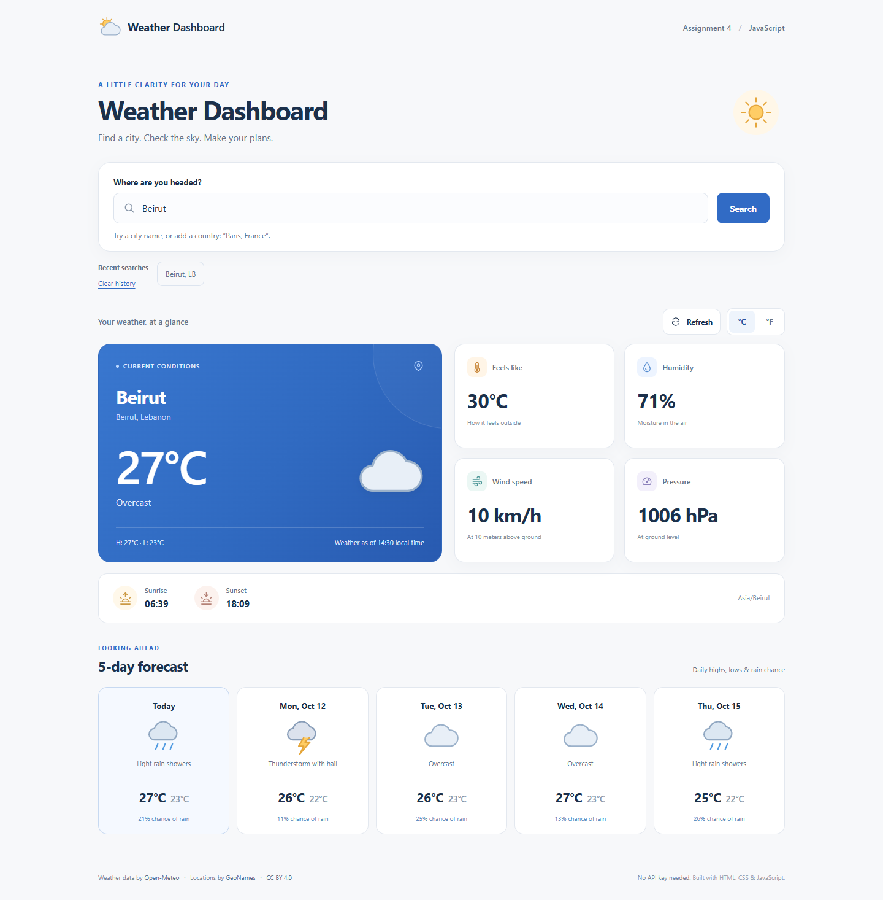

# Assignment 4 — Weather Dashboard App

A responsive weather dashboard built with **vanilla HTML, CSS, and JavaScript**.
It fetches current weather and a five-day forecast from Open-Meteo, using its
geocoding API to turn a city name into latitude and longitude.

## Run the project

1. Extract the ZIP first.
2. Open `weather-dashboard/index.html` in a current Chrome, Edge, Firefox, or Safari browser.
3. Stay connected to the internet. The app loads **Beirut** initially.
4. Enter a city and press **Search** or Enter. If several cities match, choose the intended location.

**No API key is required.** There is no account, paid service, environment file,
package installation, or build step to configure. The included `js/config.js`
contains only public endpoint URLs and display settings; it is safe to commit.
The earlier OpenWeatherMap key setup is replaced by Open-Meteo's public API.

For a local development server, you can also open the folder in VS Code and use
Live Server, or run `python -m http.server 8000` from the project folder if Python
is installed, then visit `http://localhost:8000`. This is optional.

## Features

- User-entered city search with a choice of matching locations.
- Current temperature, weather description, and a matching local SVG weather icon.
- Feels-like temperature, humidity, wind speed, surface pressure, and today's high/low.
- Sunrise/sunset and the city's timezone, displayed in city-local time.
- Five-day forecast with high/low temperatures and precipitation probability.
- Celsius/Fahrenheit buttons; conversions happen locally without extra API calls.
- Five recent cities saved in `localStorage`, with a clear-history button.
- Visible loading state for geocoding and weather requests.
- Clear validation, city-not-found, network, timeout, malformed-data, HTTP, and rate-limit errors.
- Retry and refresh buttons. A new search cancels an older request.
- Responsive desktop/mobile layout, keyboard access, labelled controls, and live status messages.
- No framework, external font, icon CDN, or third-party JavaScript dependency.

## Project structure

```text
weather-dashboard/
├── index.html                 # Semantic page and SVG weather icon symbols
├── css/
│   └── style.css              # Layout, colours, states, and responsive rules
├── js/
│   ├── config.js              # Public API URLs and settings; no secrets
│   ├── api.js                 # async/await fetch, response checks, errors, timeout
│   ├── weather.js             # Weather code mapping and formatting helpers
│   └── script.js              # DOM rendering, events, application state, storage
├── assets/
│   └── favicon.svg
├── docs/
│   ├── screenshot-desktop.png
│   └── screenshot-mobile.png
├── .gitignore
└── README.md
```

## How the code works

The form's `submit` event prevents a page reload, trims the city name, and checks
that it has at least two characters. `searchCity()` awaits `findCities()`.
The selected location is passed to `fetchWeather()`, which awaits the forecast
response. `renderWeather()` and `renderForecast()` create and update DOM elements
from the returned JSON; weather values are never hardcoded.

`fetchJSON()` wraps `fetch()` and JSON parsing in `try/catch`, explicitly checks
`response.ok`, and treats HTTP 429 and service failures as readable errors.
`finally` clears the timeout and loading state. `AbortController` stops slow or
superseded requests, while a request counter prevents old responses from
overwriting a newer search. API text is inserted with `textContent`.

Storage access is also wrapped in `try/catch`, so private browsing, blocked
storage, or corrupt saved preferences do not prevent weather searches.
Temperatures are fetched in Celsius and rounded for display; wind is km/h,
pressure is hPa, and precipitation probability is percent in both unit modes.
Open-Meteo supplies model-based current conditions, rather than a personal weather station reading.

## JavaScript Chapters 7–12

| Chapter | Concepts used in this project |
| --- | --- |
| 7 — Fundamentals | `const`/`let`, strings, numbers, objects, conditionals, functions |
| 8 — DOM and events | `querySelector`, `createElement`, `textContent`, form/button events |
| 9 — Deeper JavaScript | Scope, closures in click handlers, `filter`/`forEach`, arrays, spread syntax |
| 10 — Asynchronous JavaScript | Promises through `fetch`, `async`/`await`, sequential requests |
| 11 — Fetch and JSON | JSON parsing, `response.ok`, API URLs, loading/errors, `try/catch/finally` |
| 12 — Wrap-up and tooling | Files separated by responsibility, configuration constants, debugging, `.gitignore` |

Chapter 12's ES modules, npm, and Vite are useful next steps. This project uses
ordered `defer` scripts instead so it can open directly from the extracted ZIP.
You can use browser DevTools to inspect requests, add breakpoints, and follow
the form → geocoding → forecast → rendering flow.

## API and key setup

For this educational project, **there is no API key to obtain or use**. Requests
go directly to these HTTPS public endpoints:

- [Open-Meteo geocoding API](https://open-meteo.com/en/docs/geocoding-api): `https://geocoding-api.open-meteo.com/v1/search`
- [Open-Meteo forecast API](https://open-meteo.com/en/docs): `https://api.open-meteo.com/v1/forecast`

Names are encoded with `URL.searchParams`. Coordinates are used for weather
lookup, and `timezone=auto` returns dates and times for the selected city.
The free endpoint is for noncommercial use, including educational work; see
[Open-Meteo's terms](https://open-meteo.com/en/terms).

If you later replace the provider with one requiring a secret, do not put that
secret in public client-side code. Use an appropriate backend. `.gitignore`
already excludes `.env` files and `js/config.local.js`, but ignoring a file does
not hide a key from someone viewing a web page that loads it.

## Screenshots and submission

Desktop and mobile screenshots are included in `docs/`. They were captured from
the running app with real Open-Meteo data on **October 11, 2026**. Weather values
will change when you open the live app.



The assignment requests a ZIP, a GitHub repository link, and a screenshot:

1. Submit the provided ZIP.
2. Create a GitHub repository, upload this extracted project, and submit its repository URL.
3. Include `docs/screenshot-desktop.png`, or take a new screenshot after searching for your chosen city.

The project contains no API credentials. Commit `js/config.js` along with the
other app files. A GitHub repository link is created when you upload the project;
the downloadable ZIP does not itself create a repository.

## Quick manual checks

- Open the page: Beirut should load, with five forecast cards.
- Search for `Paris`: choose a result and verify the city and weather update.
- Submit a blank value or a single letter: a validation message should appear.
- Search for a nonsense city: the city-not-found message should appear.
- Turn off your connection and search: a readable error should appear; reconnect and use Retry.
- Switch °C/°F: current, feels-like, and forecast temperatures should all change.
- Reload: recent cities and your preferred unit should remain if browser storage is available.
- Search quickly twice: the final result should belong to the latest search.
- Resize to a mobile width: controls and cards should fit without horizontal scrolling.

## Attribution

Weather data: [Open-Meteo](https://open-meteo.com/).
Location data: [GeoNames](https://www.geonames.org/) via Open-Meteo's geocoding API.
Data are provided under [CC BY 4.0](https://creativecommons.org/licenses/by/4.0/).
The app rounds numeric values, converts temperatures when Fahrenheit is selected,
and maps WMO weather codes to local descriptive text and SVG icons.
